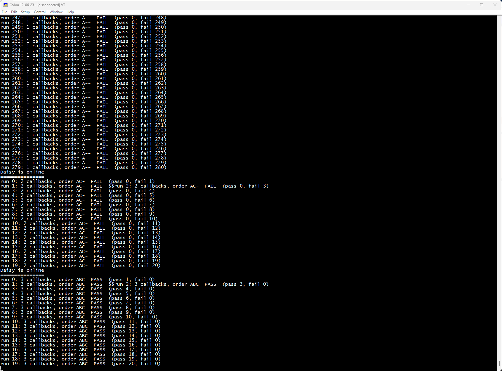

# SPI DMA queue test

Shows two bugs that make `SpiHandle` silently drop queued DMA transfers, and checks the fix for each.

`SpiHandle` runs one DMA transfer at a time. While one is running, it holds the next in a single queue slot per peripheral, and the DMA interrupt starts that job when the running transfer finishes.

**Bug 1: transmit-only and receive-only jobs never count as queued.** `SpiDmaJob::IsValidJob()` requires both buffers:

```cpp
return data_rx != nullptr && data_tx != nullptr;
```

A `DmaTransmit()` job has no RX buffer, so the slot always looks empty. The interrupt never starts the queued job, and its end callback never fires. Only full-duplex jobs (`DmaTransmitAndReceive()`) queue correctly. Fixed on branch `spi-queue-isvalidjob`, which checks the buffer that matches the job's direction, as `UartDmaJob` already does.

**Bug 2: the wait for a free slot is compiled away.** When the slot is full, `QueueDmaTransfer()` is supposed to wait until the interrupt frees it:

```cpp
while(IsDmaTransferQueuedFor(spi_idx))
{
    continue;
};
```

`queued_dma_transfers_` isn't `volatile`, and only the DMA interrupt changes it, so GCC assumes the loop can't change anything. Since GCC 10, `-ffinite-loops` (on by default at -O2 and above for C++) lets it delete the loop, and the new job overwrites the queued one. Built with `-fno-finite-loops`, the loop instead reads the slot once and spins forever. `i2c.cpp` and `uart.cpp` have the same loop. Fixed on branch `dma-queue-wait`, which puts `__COMPILER_BARRIER()` in the loop.

Bug 1 hides bug 2 on SPI: as long as the slot always looks empty, there's nothing for the loop to wait on.

## How it works

Once a second the test starts three 64-byte transfers back to back:

| Transfer | Bytes | What should happen |
|---|---|---|
| A | `0xAA` | DMA is idle, so it starts immediately |
| B | `0xBB` | DMA is busy, so B goes into the queue slot |
| C | `0xCC` | The slot is full, so the call waits until A finishes and the interrupt starts B, then queues C |

Each transfer's end callback records its letter. A run passes when three callbacks arrive in the order A, B, C.

## Results

Daisy Seed, Arm GNU Toolchain 15.2.Rel1, CMake Release build (-O3, LTO), 2026-10-13:

| libDaisy | Callbacks | On the wire | Why |
|---|---|---|---|
| **Stock master** | A | `AA…` | B and C are queued, but neither counts as a job (bug 1) |
| **`spi-queue-isvalidjob`** | A, C | `AA…` `CC…` | B now counts, but C's wait is gone, so C overwrites B (bug 2) |
| **Both fixes** | A, B, C: **PASS** | `AA…` `BB…` `CC…` | |

Every run in each stage gave the same result.



The `$$` where the run 1 and run 2 lines run together shows up after every boot in all three stages, including the one where every run passes. It comes from the USB serial port starting up, not from SPI.

## Generated code

The deleted wait (bug 2), in stock libDaisy:

- **Makefile build (-O3, no LTO):** `QueueDmaTransfer()` disables interrupts, copies the job into the slot, and returns. There's no read of the slot before the write. The same happens in `spi.cpp`, `i2c.cpp` and `uart.cpp`.
- **CMake Release build (-O3, LTO), this firmware:** all three `DmaTransmit()` calls are inlined into `main()`. Each checks whether the DMA is busy, and if it is, writes the job straight into the slot (`0x41` 'A', `0x42` 'B', `0x43` 'C' as the callback context). Nothing waits. It's the same on `spi-queue-isvalidjob`.
- **With both fixes:** the queue path reads the job's direction and the matching buffer pointer, and while the slot is full, branches back and reads them again.

## Hardware

A Daisy Seed. A Pod works too. The serial output alone is enough; a logic analyzer adds the view of what was sent.

| Analyzer channel | Seed pin | Signal |
|---|---|---|
| NSS | D7 | SPI1 chip select, low during each transfer |
| SCLK | D8 | SPI1 clock, about 390 kHz |
| Done | D9 | Short pulse from each transfer's end callback |
| MOSI | D10 | SPI1 data |
| GND | GND | |

Nothing needs to be connected to the SPI bus; the test only transmits. **On a Pod, don't use D1–D6:** they are its SD card lines.

Results are reported three ways:

- **USB serial:** one line per run, for example `run 12: 2 callbacks, order AC-  FAIL  (pass 0, fail 13)`. The port is the Seed's own USB (a virtual COM port), so any baud rate works.
- **LED:** on after a run that passed, off after one that failed.
- **Logic analyzer:** add an SPI analyzer on MOSI/SCLK/NSS (CPOL 0, CPHA 0, 8 bits, MSB first). Each block sent is 64 bytes of one value, with one Done pulse per callback.

## Build

From this branch (stock libDaisy):

```bash
cmake -S tools/spi_dma_queue_test -B build_spi_queue -G Ninja -DCMAKE_BUILD_TYPE=Release
cmake --build build_spi_queue
```

To test a fix, point `LIBDAISY_DIR` at a checkout of the branch that contains it, for example a worktree:

```bash
git worktree add ../libDaisy-spi-valid spi-queue-isvalidjob
cmake -S tools/spi_dma_queue_test -B build_spi_queue_valid -G Ninja -DCMAKE_BUILD_TYPE=Release -DLIBDAISY_DIR=../libDaisy-spi-valid
cmake --build build_spi_queue_valid
```

For both fixes, use a checkout with `dma-queue-wait` merged into `spi-queue-isvalidjob`.

A new worktree needs its submodules first: `git submodule update --init`.

Flash `spi_dma_queue_test.hex` (ST-Link / STM32CubeProgrammer) or a `.bin` made with `arm-none-eabi-objcopy -O binary` (Daisy Web Programmer).
